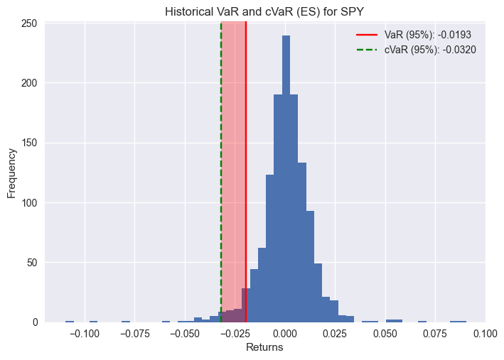
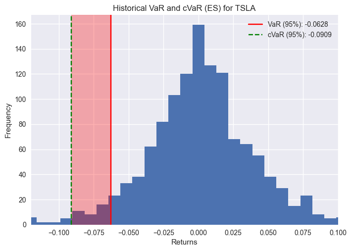

# Risk Engine

A Python-based quantitative risk analysis engine that computes portfolio risk metrics including volatility, Value at Risk (VaR), Sharpe ratio, Conditional VaR (ES), correlation matrix, beta, and portfolio volatility using LSEG Enterprise Data.

## Metrics

Metrics used to calculate portfolio risk.

```
Expected Return: Calculates the annual expected return
Volatility: Calculates an assets annualized volatility
Sharpe Ratio: Measures risk-adjusted returns
Historical VaR: Estimates the maximum expected loss at a given confidence level
CVaR (ES): Average of all returns that are worse than your VaR threshold
Correlation Matrix: How assets move together in relation to each other
Beta: Measures the sensitivity of an asset relative to market movement
Portfolio Expected Return: Calculates weighted average of each asset's expected return
Portfolio Volatility: Calculates how much the overall portfolio fluctuates
```

## Installation

```bash
git clone https://github.com/dvidsalaz/risk-engine.git
cd risk-engine
pip install -e .
```

This installs the package in editable mode using `pyproject.toml`, which also pulls in the required dependencies (`pandas`, `numpy`, `matplotlib`, `lseg-data`).

> **Note:** Live data pulls require an active LSEG session (`ld.open_session()`), which requires institutional credentials (e.g. Eikon, Workspace, or CodeBook access). If you don't have LSEG access, use the cached sample data included in this repo — see Usage below.

## Usage

```python
# Calculating Non-Parametric VaR and cVaR (ES) using Real Market Data

from risk_engine.data_loader import get_market_data
from risk_engine.risk_metrics import hist_var, cvar
from risk_engine.visualization import plot_var_cvar

tickers = ['SPY', 'TLT.O', 'GLD', 'TSLA.O']
returns = get_market_data(tickers, '2020-01-01', '2025-01-01', use_cache=True)

print(hist_var(returns))  # 95% VaR
print(cvar(returns))  # Expected Shortfall

# Visualization

var = hist_var(returns['SPY'])
spy_cvar = cvar(returns['SPY'])

tsla_var = hist_var(returns['TSLA.O'])
tsla_cvar = cvar(returns['TSLA.O'])

plot_var_cvar(returns=returns['SPY'], var=var, cvar=spy_cvar)
plot_var_cvar(returns=returns['TSLA.O'], var=tsla_var, cvar=tsla_cvar)


```

> **Note:** Tickers use LSEG RIC (Reuters Instrument Code) conventions. Suffixes like `.O` denote the listing exchange (e.g. NASDAQ) where applicable — this is why `TLT.O` and `TSLA.O` have suffixes while `SPY` and `GLD` don't.

## Sample Output




> [!NOTE]
> This project uses historical VaR rather than parametric VaR.
> Historical data captures skewness and excess kurtosis that a normal distribution assumption would fail to capture.

In the sample output, the daily returns cover **1,258 trading days** from January 2, 2020, through December 31, 2024. The 95% one-day historical VaR was **1.92% for SPY** and **6.28% for TSLA**. Each asset had 63 days when losses exceeded its VaR threshold. Across those days, the average loss (Expected Shortfall) was **3.19% for SPY** and **9.09% for TSLA**.

> [!WARNING]
> This project uses static correlation. During a crisis, correlation spikes toward 1. Assets that normally move independently begin moving together. Static correlation averages historical data. This contains calm periods, bull markets, and low volatility stretches into a single value. As a result, tail losses during stress periods are understated. A more accurate approach would implement dynamic conditional correlation (DCC) or rolling correlation — time-varying models that capture how correlation shifts during crisis periods rather than averaging it away.
